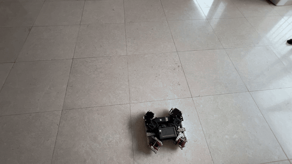
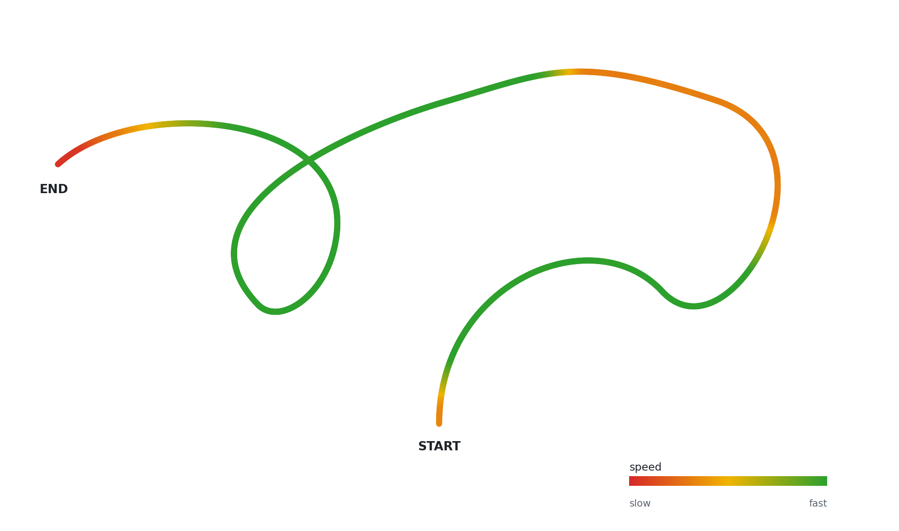
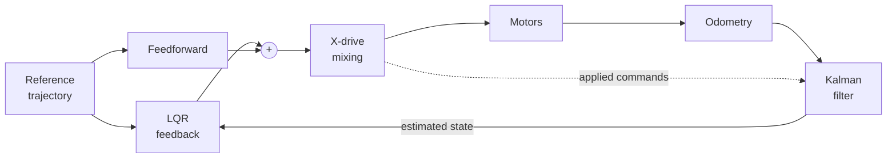
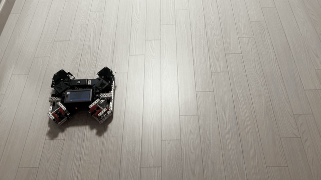
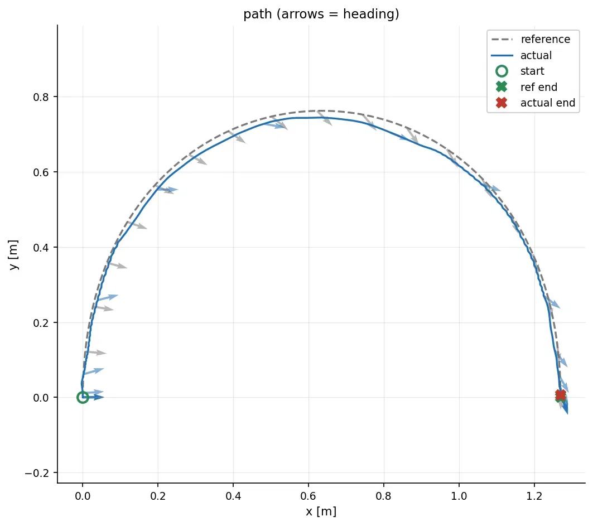
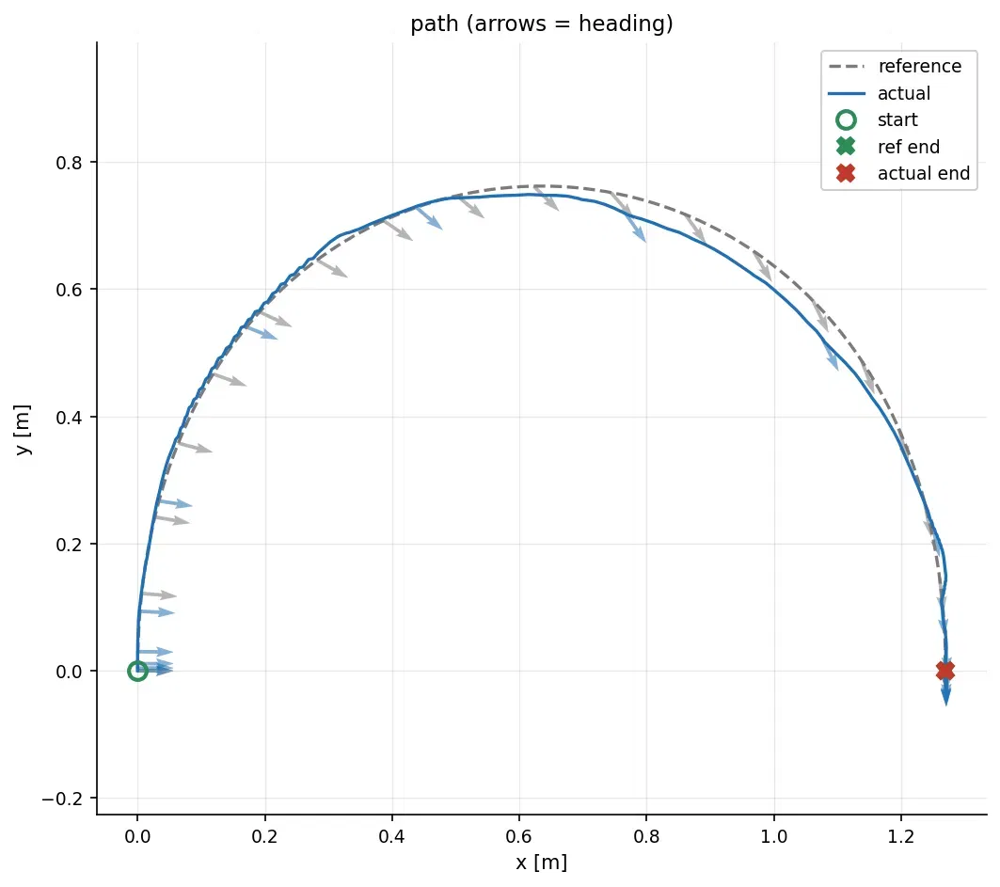
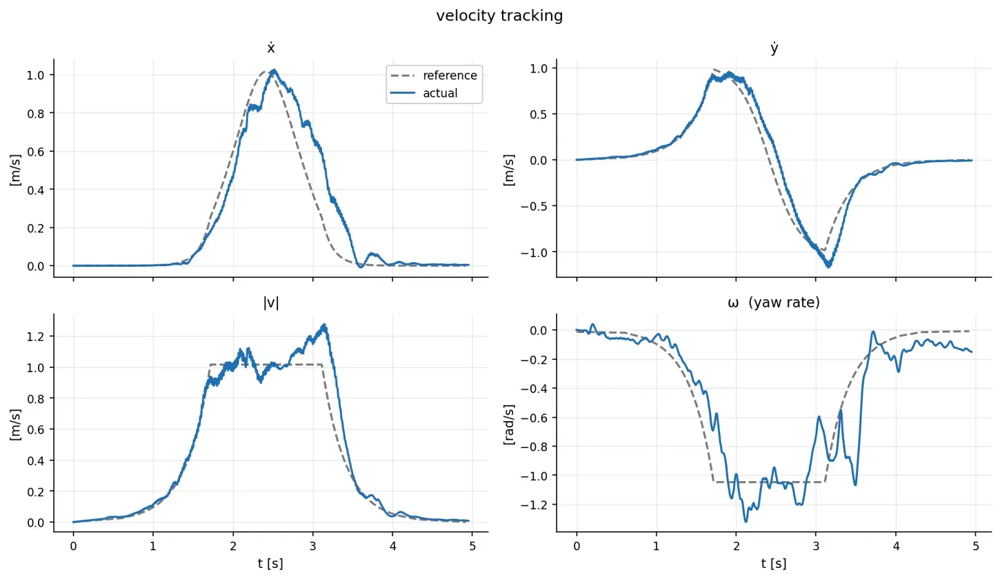
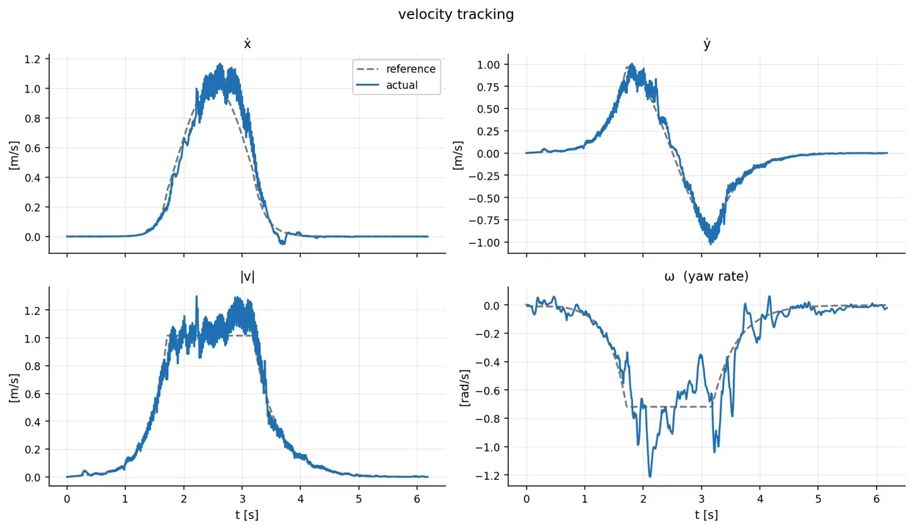
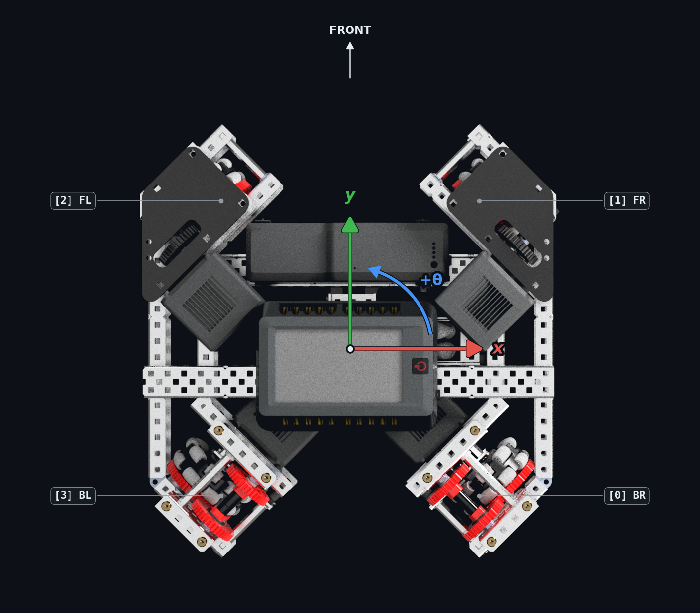

# VEX X-Drive LQG

A simple LQG motion control for VEX V5 X-Drives


<br>

*LQG demo*

## Overview


This template controls a VEX X-Drive with Linear Quadratic Gaussian (LQG). Kalman Filter (LQE) estimates the robot's position and velocity, and Linear Quadratic Regulator (LQR) turns the error into motor commands. LQR requires a linear time-invariant (LTI) model. Because X-drives are holonomic, they can be modeled this way by setting input commands as acceleration in global frame `[x, y, theta]`. Decoupling these axes reduces the kinematics into a straightforward double-integrator model. 

```math
\dot{\mathbf{x}} =
\begin{bmatrix} 0 & 1 \\ 0 & 0 \end{bmatrix} \mathbf{x} +
\begin{bmatrix} 0 \\ 1 \end{bmatrix} a,
\qquad
\mathbf{x} = \begin{bmatrix} p \\ v \end{bmatrix}
```

Instead of going through tedious trial-and-error tuning using PID on complicated cascaded loops, you choose how much you penalize error and control effort, then LQR derives the optimal gains for the model. Because the model is LTI, LQR computes the gain only once at start, and uses the same matrix the entire time. At runtime the control law is just a single matrix multiplication, $u = -K(x - x_{ref})$, plus feedforward commands. 

A double integrator model needs the velocity as well as its position, but differentiating odometry to get the velocity amplifies sensor noise. Thus, steady-state Kalman filter is used to fuse the pose computed from odometry with the model's predicted motion. Steady-state Kalman filter uses a time-invariant gain, so it can be computed once at start by the same solver that computes the LQR gains.

## Results

Both runs follow the same semicircular trajectory with different LQG gains.




<p align="center">
  
  
</p>

Moderate gain tracks smoothly but lags when the robot is accelerating, and cuts slightly inside the curve. Aggressive gains resolves most of the lag but amplifies sensor noise into motion. Yaw rate tracks worst in both trials, likely because the rotational feedforward (`kA_r`) is the least accurate part of the model.

<details>
<summary>Velocity tracking plots</summary>




</details>

## Conventions

<p align="center">
  
</p>

## User Guide

> **Note:** This is only a reference implementation, not a complete library.

All robot-specific parameters are fields of the `Config` struct in `include/lqg/config.hpp`:

- **Chassis geometry:** `centerToWheel`, `wheelRadius`, `gearRatio`, and `motorPorts`, listed in wheel order [BR, FR, FL, BL] (see [Conventions](#conventions))
- **Odometry:** tracking wheel & IMU ports, and tracking wheel specs
- **Control loop:** `dt`, the discretization interval (should be around 0.01 seconds)
- **Voltage model:** Gather data through `sysid.cpp`, then use `scipy.optimize.least_squares` to retrieve values
- **LQR weights:** `qPos`, `qVel`, `rTrans` and `qAng`, `qAngVel`, `rRot`
- **Kalman filter weights:** the same six parameters with `_f` suffix

## Acknowledgements
Lemlib (odometry, async controller), WPILib (motor model)

## License

MIT. See [LICENSE](LICENSE).